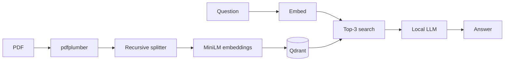

# Simple RAG Template

A minimal retrieval-augmented generation (RAG) application for answering questions about a PDF with a local LLM. It was prepared at the instructor's request as teaching material for the Decision Support Systems course at Süleyman Demirel University. For that reason the whole pipeline is a single monolithic file, `app.py`, with a basic ETL step for ingestion and no orchestration framework, so every step can be read and modified directly.

## Pipeline

**Ingestion (ETL)**

1. Text is extracted from the uploaded PDF with pdfplumber.
2. A recursive splitter (paragraph, then sentence, then word boundaries) produces chunks of about 500 characters with a 50-character overlap.
3. Chunks are embedded with `all-MiniLM-L6-v2` (384 dimensions) and stored in Qdrant with cosine distance.

**Querying**

1. The question is embedded with the same model.
2. The three most similar chunks are retrieved from Qdrant.
3. The chunks are added to the prompt as context and the answer is streamed from a local model through LM Studio's OpenAI-compatible API.



## Running locally

Requirements: Python 3.10+, Docker and [LM Studio](https://lmstudio.ai) with a loaded model and the local server running on port 1234.

```bash
docker compose up -d              # Qdrant on localhost:6333
pip install -r requirements.txt
streamlit run app.py
```

Upload a PDF from the sidebar, index it, then ask questions in the chat. The interface is in Turkish.

## Scope

This is a teaching template, intentionally kept simple for classroom use, rather than a production system. It indexes one document at a time (a new upload replaces the collection) and does not implement reranking, hybrid search or source citations.

`docs/rag.pdf` is a survey paper on RAG (Gupta, Ranjan and Singh) used as background reading and as a sample document.
